<h1 align="center">Sakuga VFX</h1>

<p align="center"><em>おなじみの UI に、アニメのような手応えを。</em></p>

<p align="center">
  <a href="https://chenlongapps.github.io/sakuga-vfx-i18n/gallery/?lang=ja"></a>
</p>

<p align="center">
  
  
  
  
  
  
</p>

<p align="center">
  <a href="README.md">English</a> · <a href="README.zh-CN.md">简体中文</a> · <strong>日本語</strong>
</p>

## プロジェクトについて

Sakuga VFX は、おなじみの UI コントロールにアニメのような反応を加えるコンポーネント集です。普段はシンプルな見た目ですが、押したりドラッグしたりすると、つぶれて跳ね返り、煙や衝撃波、結晶の破片、斬撃、水しぶき、煙の輪が重なります。「ドン！」「カチッ」「ズザッ」といった漫画風の描き文字は、英語・簡体字中国語・日本語に対応しています。

エフェクトは Canvas 2D でリアルタイムに描画します。描き文字は GPT Image で描き、パスに変換して各ファイルに埋め込みました。各コンポーネントは単一の JavaScript ファイルで、依存パッケージのインストールやビルドは不要です。MIT ライセンスで公開しています。

このフォークは Justin Finkelman の [Sakuga VFX](https://github.com/finktheartist/sakuga-vfx) を元に、ギャラリーと各コンポーネントのデモを日本語・英語・簡体字中国語で提供します。

## オンラインデモ

**[日本語デモを見る](https://chenlongapps.github.io/sakuga-vfx-i18n/gallery/?lang=ja)** · [English](https://chenlongapps.github.io/sakuga-vfx-i18n/gallery/?lang=en) · [简体中文](https://chenlongapps.github.io/sakuga-vfx-i18n/gallery/?lang=zh-CN)

`?lang=` で画面の表示と描き文字の両方が切り替わります。`?lang` がない場合は、保存した選択、ブラウザーの言語、英語の順に適用されます。言語リンクをクリックすると選択が保存され、次回以降も引き継がれます。「ドキュメントとデモ」からコンポーネントのページを開いても、URL に選択した言語が引き継がれます。

## コンポーネントショーケース

11 種類のコンポーネント、12 のデモ（ボタンは 2 種類のバリエーションを含みます）。以下の Animated WebP はすべて、実際に動作しているコンポーネントをマウス・キーボード・タッチ操作で録画したものです。アニメーションをクリックすると対応するオンラインデモが開きます。

<table>
<tr>
<td width="50%" valign="top"><div align="center">
<b>プライマリボタン</b><br>
<a href="https://chenlongapps.github.io/sakuga-vfx-i18n/button/?lang=ja">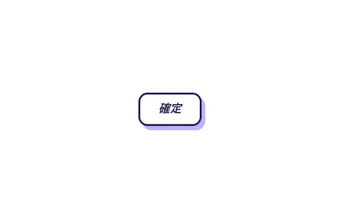</a><br>
押すとつぶれ、離すと衝撃波と煙が広がり、最後に光るチェックが付きます。<br>
<a href="https://chenlongapps.github.io/sakuga-vfx-i18n/button/?lang=ja">デモ</a> · <a href="button/README.md">ドキュメント</a>
</div></td>
<td width="50%" valign="top"><div align="center">
<b>セカンダリボタン</b><br>
<a href="https://chenlongapps.github.io/sakuga-vfx-i18n/button/?lang=ja">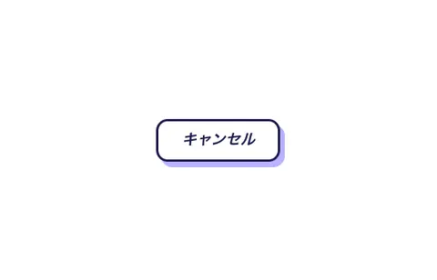</a><br>
控えめなバリエーション：小さくつぶれ、角に 3 本のくさびが飛びます。<br>
<a href="https://chenlongapps.github.io/sakuga-vfx-i18n/button/?lang=ja">デモ</a> · <a href="button/README.md">ドキュメント</a>
</div></td>
</tr>
<tr>
<td width="50%" valign="top"><div align="center">
<b>トグルスイッチ</b><br>
<a href="https://chenlongapps.github.io/sakuga-vfx-i18n/toggle/?lang=ja">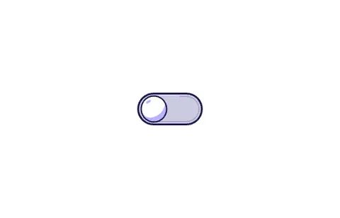</a><br>
つまみが残像を引いて両端で跳ね返り、水しぶきが上がります。液体はオンで満ち、オフで引きます。<br>
<a href="https://chenlongapps.github.io/sakuga-vfx-i18n/toggle/?lang=ja">デモ</a> · <a href="toggle/README.md">ドキュメント</a>
</div></td>
<td width="50%" valign="top"><div align="center">
<b>スライダー</b><br>
<a href="https://chenlongapps.github.io/sakuga-vfx-i18n/slider/?lang=ja">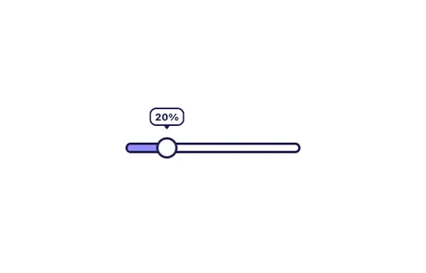</a><br>
つまみがしずく形に伸びます。すばやく動かすと、背後に雲がわき上がります。<br>
<a href="https://chenlongapps.github.io/sakuga-vfx-i18n/slider/?lang=ja">デモ</a> · <a href="slider/README.md">ドキュメント</a>
</div></td>
</tr>
<tr>
<td width="50%" valign="top"><div align="center">
<b>チェックボックス</b><br>
<a href="https://chenlongapps.github.io/sakuga-vfx-i18n/checkbox/?lang=ja">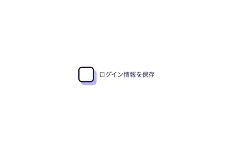</a><br>
2 本の弧が枠を巡り、結晶が飛んでチェックマークが描かれます。<br>
<a href="https://chenlongapps.github.io/sakuga-vfx-i18n/checkbox/?lang=ja">デモ</a> · <a href="checkbox/README.md">ドキュメント</a>
</div></td>
<td width="50%" valign="top"><div align="center">
<b>ラジオボタン</b><br>
<a href="https://chenlongapps.github.io/sakuga-vfx-i18n/radio/?lang=ja">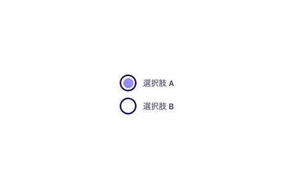</a><br>
丸いマークがくさびの扇と煙を伴って弾み、中空の「ポン」が弾けます。<br>
<a href="https://chenlongapps.github.io/sakuga-vfx-i18n/radio/?lang=ja">デモ</a> · <a href="radio/README.md">ドキュメント</a>
</div></td>
</tr>
<tr>
<td width="50%" valign="top"><div align="center">
<b>テキスト入力欄</b><br>
<a href="https://chenlongapps.github.io/sakuga-vfx-i18n/input/?lang=ja">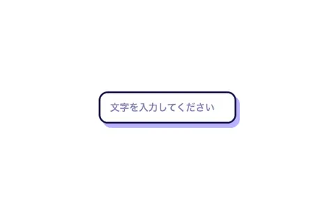</a><br>
文字を入力するたびにカーソルの位置で砂ぼこりが舞い、枠も少し縮みます。<br>
<a href="https://chenlongapps.github.io/sakuga-vfx-i18n/input/?lang=ja">デモ</a> · <a href="input/README.md">ドキュメント</a>
</div></td>
<td width="50%" valign="top"><div align="center">
<b>タブ</b><br>
<a href="https://chenlongapps.github.io/sakuga-vfx-i18n/tabs/?lang=ja">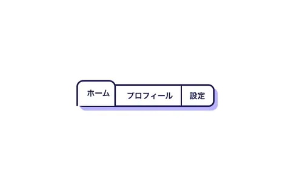</a><br>
浮き上がった選択枠が伸びながら滑り、着地時にくさびと煙が出ます。<br>
<a href="https://chenlongapps.github.io/sakuga-vfx-i18n/tabs/?lang=ja">デモ</a> · <a href="tabs/README.md">ドキュメント</a>
</div></td>
</tr>
<tr>
<td width="50%" valign="top"><div align="center">
<b>プログレスバー</b><br>
<a href="https://chenlongapps.github.io/sakuga-vfx-i18n/progress/?lang=ja">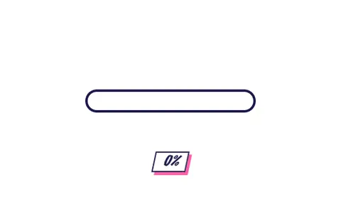</a><br>
雷雲が先端を進み、小石が舞い上がります。完了時は衝撃波とチェックマークが弾けます。<br>
<a href="https://chenlongapps.github.io/sakuga-vfx-i18n/progress/?lang=ja">デモ</a> · <a href="progress/README.md">ドキュメント</a>
</div></td>
<td width="50%" valign="top"><div align="center">
<b>星評価</b><br>
<a href="https://chenlongapps.github.io/sakuga-vfx-i18n/rating/?lang=ja">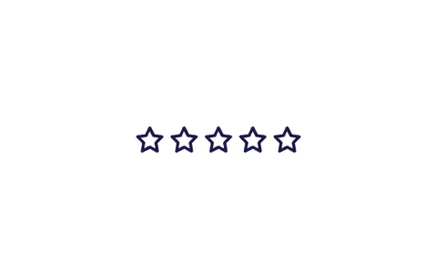</a><br>
星が順に弾むように光り、5 つ星で衝撃波が広がります。<br>
<a href="https://chenlongapps.github.io/sakuga-vfx-i18n/rating/?lang=ja">デモ</a> · <a href="rating/README.md">ドキュメント</a>
</div></td>
</tr>
<tr>
<td width="50%" valign="top"><div align="center">
<b>トースト通知</b><br>
<a href="https://chenlongapps.github.io/sakuga-vfx-i18n/toast/?lang=ja">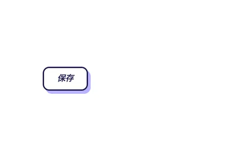</a><br>
速度線を引いて飛び込み、砂ぼこりの中で止まります。閉じると縮んで消えます。<br>
<a href="https://chenlongapps.github.io/sakuga-vfx-i18n/toast/?lang=ja">デモ</a> · <a href="toast/README.md">ドキュメント</a>
</div></td>
<td width="50%" valign="top"><div align="center">
<b>ツールチップ</b><br>
<a href="https://chenlongapps.github.io/sakuga-vfx-i18n/tooltip/?lang=ja">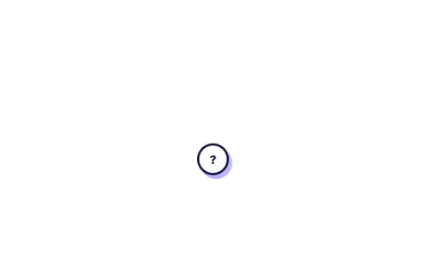</a><br>
ヒントが漫画の吹き出しのように飛び出し、煙と輪が広がります。<br>
<a href="https://chenlongapps.github.io/sakuga-vfx-i18n/tooltip/?lang=ja">デモ</a> · <a href="tooltip/README.md">ドキュメント</a>
</div></td>
</tr>
</table>

## 主な特徴

- **ばねによる動き。** つぶれ、伸び、行き過ぎはあらかじめ決めた CSS アニメーションではなく、フレームごとに計算しています。
- **手描きのような物理演出。** 煙、衝撃波、結晶、くさび、斬撃、水しぶき、煙の輪を Canvas 2D で描画します。
- **ローカライズされた描き文字。** 「ドン！」「カチッ」「ズザッ」は `<html lang>` に従って切り替わり、訳がない場合は日本語原版を使います。
- **1 ファイル・設定不要。** 各コンポーネントは `<script>` タグ 1 つで読み込めます。npm のインストールもビルドも不要です。
- **本物のフォーム控件。** フォーカス、キーボード、タッチに対応し、`ElementInternals` を通じてネイティブなフォーム値を提供します。
- **テーマ変更が可能。** ページの `:root` で `--sk-*` 変数（例: `--sk-acc`）を上書きできます。`prefers-reduced-motion` が有効な場合、エフェクトは無効になりますが状態変化は残ります。

## クイックスタート

リポジトリをローカルで配信してデモを試すか、コンポーネントのファイルを 1 つプロジェクトにコピーします。

```sh
python3 -m http.server 8000
# http://localhost:8000/gallery/?lang=ja を開く
```

```html
<script src="button.js"></script>
<sakuga-button>確定</sakuga-button>

<script src="toggle.js"></script>
<sakuga-toggle label="通知"></sakuga-toggle>

<script src="progress.js"></script>
<sakuga-progress label="アップロード中"></sakuga-progress>   <!-- el.set(0.4) で進捗を更新 -->
```

## インストールと使い方

インストールするパッケージはありません。ギャラリーで「.js をダウンロード」または「ソースをコピー」を選ぶか、[`button/button.js`](button/button.js) のようにリポジトリからファイルを直接コピーします。`<script>` タグで読み込むとカスタム要素として使えます。

各コンポーネントの README に属性・プロパティ・イベントの一覧があります。トグルスイッチ、スライダー、チェックボックス、ラジオボタン、テキスト入力欄、星評価は `<form>` の中で使えます。`name` を設定すると、値がフォームと一緒に送信されます。

```js
const el = document.querySelector('sakuga-button');
el.addEventListener('click', async () => {
  await save();
  el.done();          // 光を伴うチェックが乗り、1.8 秒後に消えます
});
el.done(0);           // 次のクリックまでチェックを残すこともできます
el.impact();          // クリックなしで演出を再生します
```

各ファイルには共通コア（ばね、エフェクト層、描き文字のパス）が内嵌されています。最初に読み込まれたスクリプトが `window.SakugaFX` を設定し、後から読み込むコンポーネントは同じキャンバスとアニメーションループを再利用します。トグルスイッチはさらに、内部の小さなキャンバスに筐体・つまみ・液体を描きます。

見た目は白い紙をベースに、白と淡紫のエフェクト、紫の描線、ピンクのアクセント、そして確認のたびに弾けるインパクトフレームです。控件の色は `--sk-*` 変数（`--sk-ink`、`--sk-card`、`--sk-pri`、`--sk-acc` など）で決まり、ページ側の `:root { --sk-acc: ... }` が既定値より優先されます。

## コンポーネント一覧

| コンポーネント | 要素 | 演出 | ドキュメント |
|---|---|---|---|
| ボタン（プライマリ／セカンダリ） | `<sakuga-button>` | 押すとつぶれ、離すとインパクトフレーム、煙、衝撃波、描き文字が弾けます。`done()` でチェックが付きます。セカンダリは小さなつぶれと 3 本のくさびです。 | [README](button/README.md) |
| トグルスイッチ | `<sakuga-toggle>` | つまみが残像を引いて両端で跳ね返り、水しぶきと各言語の描き文字が出ます。オンで液体が満ち、オフで引いていきます。 | [README](toggle/README.md) |
| スライダー | `<sakuga-slider>` | つまみがしずく形に伸び、ばねで遅れて追従します。速く動かすと雲がわき、離すと三日月が先へ飛びます。 | [README](slider/README.md) |
| チェックボックス | `<sakuga-checkbox>` | 2 本の弧が枠を巡り、結晶が飛んでチェックが描かれ、点線の描き文字が弾けます。 | [README](checkbox/README.md) |
| ラジオボタン | `<sakuga-radio>` | 丸いマークがくさびの扇、2 つの煙、中空の「ポン」とともに現れます。 | [README](radio/README.md) |
| テキスト入力欄 | `<sakuga-input>` | 文字を入力するたびにカーソルの位置で砂ぼこりが舞います。 | [README](input/README.md) |
| タブ | `<sakuga-tabs>` | 浮き上がった選択枠が伸びながら滑り、着地時にくさびと煙が出ます。 | [README](tabs/README.md) |
| プログレスバー | `<sakuga-progress>` | 雷雲が先端を進み、小石が舞い上がって「ゴゴゴゴ」が現れます。完了時は衝撃波、描き文字、チェックで締めくくります。 | [README](progress/README.md) |
| 星評価 | `<sakuga-rating>` | 星が順に弾むように光り、5 つ星で衝撃波が広がります。 | [README](rating/README.md) |
| トースト通知 | `<sakuga-toast>` | スピード線を引いて飛び込み、砂ぼこりを上げて止まります。閉じると縮んで消えます。 | [README](toast/README.md) |
| ツールチップ | `<sakuga-tooltip>` | ヒントが漫画の吹き出しのように煙と描き文字を伴って飛び出します。 | [README](tooltip/README.md) |

## 国際化

ギャラリーと各コンポーネントのデモは `?lang=en`、`?lang=zh-CN`、`?lang=ja` に対応しています。切り替えると画面の文案と Canvas の描き文字の両方が変わり、選択は次回以降も保存されます。単独で使う場合は、ページの `<html lang>` に `en`、`zh-CN`、`ja` のいずれかを指定してください。エフェクトが始まるたびに言語を参照し、未指定や訳がない場合は日本語原版を使います。

描き文字自体が言語によって変わるため、ショーケースでは言語ごとに別の Animated WebP を録画しています。コンポーネントの動作とタイミングは同一です。字形素材は [`art/words/<lang>/`](art/words/) にあり、ビルドスクリプトがパスを各コンポーネントに埋め込みます。

## 開発

```sh
python3 -m http.server 8000                            # リポジトリのルートで配信
node tools/build.mjs                                   # core.js を各コンポーネントに書き込む
node tools/build.mjs --check                           # コピーが最新か確認
node tools/test.mjs http://localhost:8000/gallery/     # ヘッドレス Chrome で全控件を操作
node tools/shot.mjs URL OUT W H SCALE                  # ページ全体のスクリーンショット
```

`core.js` は共通コアのソースです。編集後は `node tools/build.mjs` を実行すると、`// >>> sakuga core` のマーカー間に各コンポーネントとスキルへコピーされます。`tools/test.mjs` はスマートフォン幅で実際のタッチ・キーイベントを使ってすべての控件を操作し、フォーム値、横スクロール、言語の検出・切り替え・永続化を検査して、失敗時は終了コード 1 を返します。`tools/shot.mjs` はページ全体の撮影に使います。どちらも Chrome または Chromium が必要です（通常と異なる場所にある場合は `CHROME=...` を指定）。素材の生成とパス変換は[素材ガイド](art/words/README.md)を参照してください。

ショーケースのアニメーションを再生成するには（Node 22+、ffmpeg、libwebp の `img2webp` または Python Pillow が必要）:

```sh
node tools/record-webp.mjs                                      # 12 デモ x 3 言語すべて
node tools/record-webp.mjs --only toggle,slider --lang ja        # 指定コンポーネント／言語
node tools/record-webp.mjs --fps 30 --duration 5 --image-width 480 # 参数をカスタマイズ
node tools/record-webp.mjs --base-url http://localhost:8000      # 既存のサーバーに接続
```

このスクリプトは実際のコンポーネントを配信し、本物のマウス／キーボード操作で再生し、共有コアを固定フレームレートで進めて、`docs/webp/<demo>.<lang>.webp` と `manifest.json` を出力します。`--crop auto` でコンポーネント周囲に自動裁剪し、`--keep-frames` で再エンコード用の PNG を保持できます。

## 既知の制限

- **ヘッドレス Chromium で確認済み**です。実際のタッチ・キーイベントとフレーム単位の撮影を使いましたが、Safari、Firefox、実機、スクリーンリーダーでは未検証です。
- **エフェクトキャンバスは最前面にあり、ポインタ events を無視します。** そのためモーダルや固定ヘッダーの上をエフェクトが通り抜けることがあります。
- **控件の背後にあるエフェクトは控件内部に描かれる**ため（ボタンとプログレスバーの衝撃波、星 5 つの破裂）、`overflow: hidden` の親要素で切り取られます。
- **モーション低減**を有効にするとすべてのエフェクトが止まりますが、ばねの動きと状態変化は残ります。

## ライセンス

Justin Finkelman の [Sakuga VFX](https://github.com/finktheartist/sakuga-vfx) を元にしています。MIT ライセンスです。コンポーネントを再配布する際は [LICENSE](LICENSE) を同梱してください。原プロジェクトの日本語の描き文字とトグルスイッチのフレームは、Higgsfield 経由で GPT Image を使って生成されました。
