<h1 align="center">Sakuga VFX</h1>

<p align="center"><em>Ordinary controls. Anime reactions.</em></p>

<p align="center">
  <a href="https://chenlongapps.github.io/sakuga-vfx-i18n/gallery/?lang=en"></a>
</p>

<p align="center">
  
  
  
  
  
  
</p>

<p align="center">
  <strong>English</strong> · <a href="README.zh-CN.md">简体中文</a> · <a href="README.ja.md">日本語</a>
</p>

## About

Ordinary UI controls that react like anime. At rest they are plain. Use one and it squashes and overshoots on springs, surrounded by smoke puffs, impact bursts, crystal chips, slashes, splashes and smoke rings. Manga sound-effect lettering such as `BOOM!`, `CLICK!` and `SKRR!` is available in English, Simplified Chinese and Japanese.

The effects are drawn in code with Canvas 2D; the lettering was painted with GPT Image, traced to paths and embedded in each file. Every component is a standalone JavaScript file with no dependencies and no build step. MIT licensed.

This fork of Justin Finkelman's [Sakuga VFX](https://github.com/finktheartist/sakuga-vfx) provides the gallery and standalone demos in English, Simplified Chinese and Japanese.

## Live Demo

**[Open the gallery in English](https://chenlongapps.github.io/sakuga-vfx-i18n/gallery/?lang=en)** · [简体中文](https://chenlongapps.github.io/sakuga-vfx-i18n/gallery/?lang=zh-CN) · [日本語](https://chenlongapps.github.io/sakuga-vfx-i18n/gallery/?lang=ja)

The `?lang=` switch localizes both the interface and the drawn sound effects. Without a `?lang` tag the site uses your saved choice, then your browser language, then English; clicking a language link saves the choice for later visits. Every **Docs** link keeps the selected language in its URL.

## Component Showcase

Twelve demos of eleven components, including both button variants. Every Animated WebP below is a real recording of the running component, driven by mouse, keyboard and touch events. Click an animation to open its live demo.

<table>
<tr>
<td width="50%" valign="top"><div align="center">
<b>Primary Button</b><br>
<a href="https://chenlongapps.github.io/sakuga-vfx-i18n/button/?lang=en">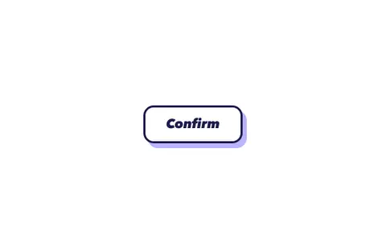</a><br>
Press, squash flat, impact burst and clouds, then a check with a glint.<br>
<a href="https://chenlongapps.github.io/sakuga-vfx-i18n/button/?lang=en">Demo</a> · <a href="button/README.md">Docs</a>
</div></td>
<td width="50%" valign="top"><div align="center">
<b>Secondary Button</b><br>
<a href="https://chenlongapps.github.io/sakuga-vfx-i18n/button/?lang=en">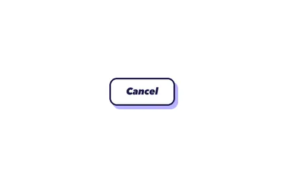</a><br>
The quiet variant: a small squash and three corner wedges.<br>
<a href="https://chenlongapps.github.io/sakuga-vfx-i18n/button/?lang=en">Demo</a> · <a href="button/README.md">Docs</a>
</div></td>
</tr>
<tr>
<td width="50%" valign="top"><div align="center">
<b>Toggle</b><br>
<a href="https://chenlongapps.github.io/sakuga-vfx-i18n/toggle/?lang=en">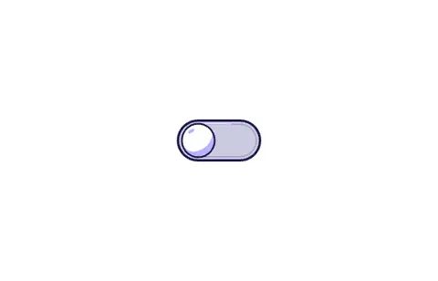</a><br>
The knob smears, rebounds and splashes; liquid floods in and out.<br>
<a href="https://chenlongapps.github.io/sakuga-vfx-i18n/toggle/?lang=en">Demo</a> · <a href="toggle/README.md">Docs</a>
</div></td>
<td width="50%" valign="top"><div align="center">
<b>Slider</b><br>
<a href="https://chenlongapps.github.io/sakuga-vfx-i18n/slider/?lang=en">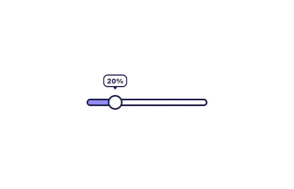</a><br>
Drag fast and cumulus rolls up behind the teardrop thumb.<br>
<a href="https://chenlongapps.github.io/sakuga-vfx-i18n/slider/?lang=en">Demo</a> · <a href="slider/README.md">Docs</a>
</div></td>
</tr>
<tr>
<td width="50%" valign="top"><div align="center">
<b>Checkbox</b><br>
<a href="https://chenlongapps.github.io/sakuga-vfx-i18n/checkbox/?lang=en">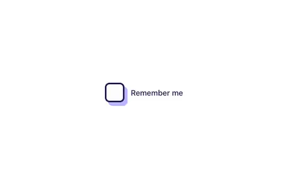</a><br>
Two crescents swing round, crystals fly and the tick draws itself.<br>
<a href="https://chenlongapps.github.io/sakuga-vfx-i18n/checkbox/?lang=en">Demo</a> · <a href="checkbox/README.md">Docs</a>
</div></td>
<td width="50%" valign="top"><div align="center">
<b>Radio</b><br>
<a href="https://chenlongapps.github.io/sakuga-vfx-i18n/radio/?lang=en">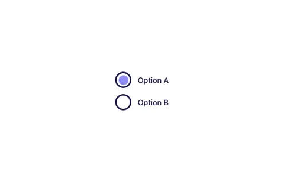</a><br>
The dot springs in with a fan of wedges, puffs and a hollow pop.<br>
<a href="https://chenlongapps.github.io/sakuga-vfx-i18n/radio/?lang=en">Demo</a> · <a href="radio/README.md">Docs</a>
</div></td>
</tr>
<tr>
<td width="50%" valign="top"><div align="center">
<b>Text Input</b><br>
<a href="https://chenlongapps.github.io/sakuga-vfx-i18n/input/?lang=en">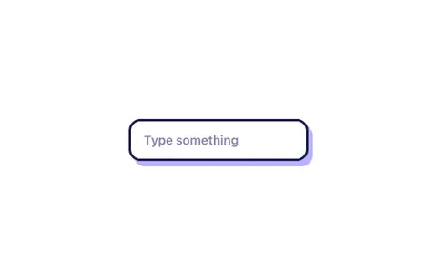</a><br>
Every key kicks up dust at the caret; the field gives a little.<br>
<a href="https://chenlongapps.github.io/sakuga-vfx-i18n/input/?lang=en">Demo</a> · <a href="input/README.md">Docs</a>
</div></td>
<td width="50%" valign="top"><div align="center">
<b>Tabs</b><br>
<a href="https://chenlongapps.github.io/sakuga-vfx-i18n/tabs/?lang=en">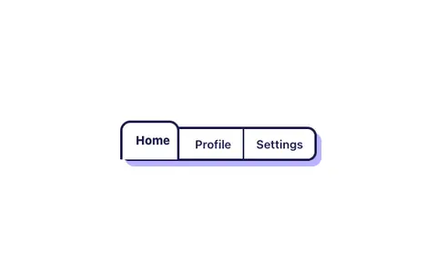</a><br>
The raised tab stretches, slides and lands with wedges and a puff.<br>
<a href="https://chenlongapps.github.io/sakuga-vfx-i18n/tabs/?lang=en">Demo</a> · <a href="tabs/README.md">Docs</a>
</div></td>
</tr>
<tr>
<td width="50%" valign="top"><div align="center">
<b>Progress</b><br>
<a href="https://chenlongapps.github.io/sakuga-vfx-i18n/progress/?lang=en">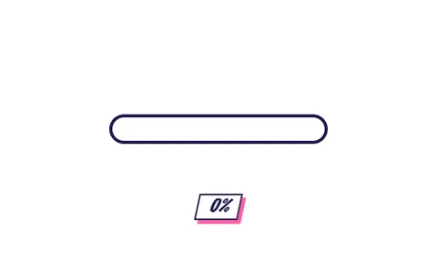</a><br>
A storm cloud rides the edge, pebbles lift, and the end lands with a burst.<br>
<a href="https://chenlongapps.github.io/sakuga-vfx-i18n/progress/?lang=en">Demo</a> · <a href="progress/README.md">Docs</a>
</div></td>
<td width="50%" valign="top"><div align="center">
<b>Rating</b><br>
<a href="https://chenlongapps.github.io/sakuga-vfx-i18n/rating/?lang=en">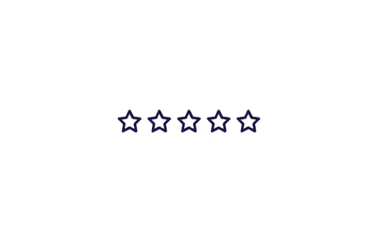</a><br>
Stars pop in one after another; five stars get a burst.<br>
<a href="https://chenlongapps.github.io/sakuga-vfx-i18n/rating/?lang=en">Demo</a> · <a href="rating/README.md">Docs</a>
</div></td>
</tr>
<tr>
<td width="50%" valign="top"><div align="center">
<b>Toast</b><br>
<a href="https://chenlongapps.github.io/sakuga-vfx-i18n/toast/?lang=en">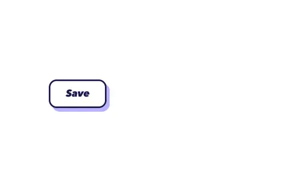</a><br>
Streaks in as a smear, lands in dust, then shrinks away.<br>
<a href="https://chenlongapps.github.io/sakuga-vfx-i18n/toast/?lang=en">Demo</a> · <a href="toast/README.md">Docs</a>
</div></td>
<td width="50%" valign="top"><div align="center">
<b>Tooltip</b><br>
<a href="https://chenlongapps.github.io/sakuga-vfx-i18n/tooltip/?lang=en">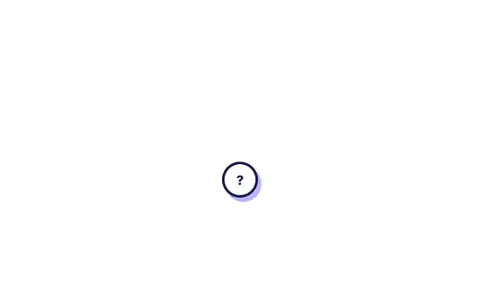</a><br>
The hint springs out like a speech bubble with puffs and a ring.<br>
<a href="https://chenlongapps.github.io/sakuga-vfx-i18n/tooltip/?lang=en">Demo</a> · <a href="tooltip/README.md">Docs</a>
</div></td>
</tr>
</table>

## Highlights

- **Spring-driven motion.** Squash, stretch and overshoot are integrated frame by frame, not canned CSS keyframes.
- **Hand-drawn physics.** Canvas 2D puffs, bursts, crystals, wedges, slashes, splashes and rings are drawn in code.
- **Localized impact words.** `BOOM!`, `CLICK!`, `SKRR!` and friends follow `<html lang>`; missing translations fall back to Japanese.
- **One file, zero setup.** Each component is a single script loaded with a plain `<script>` tag. No npm install, no build step.
- **AI-ready handoff.** In the gallery, **Copy AI Prompt** produces a localized integration prompt with the component's Skill, source and docs links for Codex, Claude Code, OpenCode, Cursor and other AI coding tools.
- **Real controls.** Focus, keyboard, touch and native `<form>` values work through `ElementInternals`.
- **Themable.** Override `--sk-*` CSS variables (for example `--sk-acc`) from your own `:root`; `prefers-reduced-motion` turns effects off while keeping state changes.

## Install the Skill

Install the `sakuga-vfx` skill with the [skills](https://skills.sh/) CLI:

```sh
npx skills add chenlongapps/sakuga-vfx-i18n
```

It installs the skill for the AI coding tools it detects, such as Claude Code, Codex, OpenCode and Cursor. Add `-g` for a global install. No clone or manual copying is needed.

Installing is optional: the gallery's **Copy AI Prompt** already includes the raw `SKILL.md` URL.

## Components

| Component | Element | What happens | Docs |
|---|---|---|---|
| Button (primary / secondary) | `<sakuga-button>` | Press squashes flat; release inverts one frame, bursts behind it, rolls clouds off the corners and lands `BOOM!`. `done()` adds a check. The secondary variant is a small squash and three wedges. | [README](button/README.md) |
| Toggle | `<sakuga-toggle>` | The knob stretches into a smear and rebounds with a splash and a localized impact word; liquid floods on opening and rushes back on closing. | [README](toggle/README.md) |
| Slider | `<sakuga-slider>` | The thumb stretches into a teardrop and lags on a spring. Drag fast and cumulus rolls up behind it; let go and a crescent flies ahead. | [README](slider/README.md) |
| Checkbox | `<sakuga-checkbox>` | Two crescents swing round the box, crystals fly, the tick draws itself, `SKRR!` in dotted letters. | [README](checkbox/README.md) |
| Radio | `<sakuga-radio>` | The dot springs in with a fan of wedges, two puffs and a hollow `POP!`. | [README](radio/README.md) |
| Text input | `<sakuga-input>` | Every key kicks up dust where the caret is. | [README](input/README.md) |
| Tabs | `<sakuga-tabs>` | The raised tab slides while stretching and lands with wedges and a puff. | [README](tabs/README.md) |
| Progress | `<sakuga-progress>` | A storm cloud rides the leading edge, pebbles lift off the ground and `RUMBLE` appears. It ends with a burst, `BOOM!` and a check. | [README](progress/README.md) |
| Rating | `<sakuga-rating>` | Stars pop in one after another; five gets a burst. | [README](rating/README.md) |
| Toast | `<sakuga-toast>` | Streaks in as a smear, lands in dust with `SKRR!`, leaves by shrinking. | [README](toast/README.md) |
| Tooltip | `<sakuga-tooltip>` | The hint springs out like a speech bubble with puffs and `CLICK!`. | [README](tooltip/README.md) |

## Internationalization

The gallery and every component demo accept `?lang=en`, `?lang=zh-CN` and `?lang=ja`. The switch changes both interface copy and Canvas lettering, and the choice is remembered for later visits. For standalone use, set your page's `<html lang>` to `en`, `zh-CN` or `ja`; each effect reads the language when it is triggered. If the language is unset or that effect has no translation, the original Japanese lettering is used.

Because the impact words are localized, the showcase records a separate Animated WebP for each language; the component behavior and timing are identical. The lettering sources live in [`art/words/<lang>/`](art/words/), and the build script embeds their traced paths in every component file.

## Known Limits

- **Checked in headless Chromium,** with real touch and key events and frame-by-frame sheets. Not yet tried in Safari or Firefox, on a real phone, or with a screen reader.
- **The effects canvas sits on top of everything,** at the highest z-index, and ignores the pointer. Effects can fly over a modal or a sticky header.
- **Effects behind a control are drawn inside it** (the button's and the progress bar's bursts, the five-star burst) and are cut off by a parent with `overflow: hidden`.
- **Reduced motion** turns every effect off; the springs and the state changes stay.

## License

Based on [Sakuga VFX](https://github.com/finktheartist/sakuga-vfx) by Justin Finkelman. MIT licensed — include [LICENSE](LICENSE) with any component files you redistribute. The original Japanese lettering and toggle frames were generated with GPT Image through Higgsfield for the upstream project.
