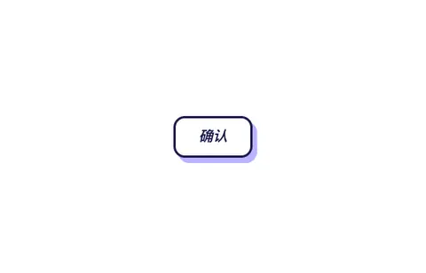
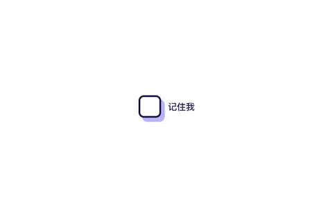
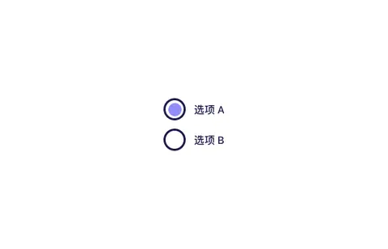
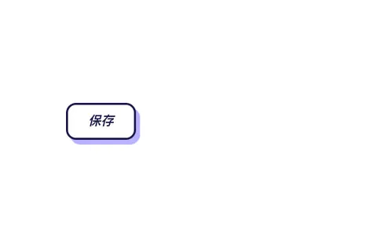

<h1 align="center">Sakuga VFX</h1>

<p align="center"><em>普通控件，动画般的回应。</em></p>

<p align="center">
  <a href="https://chenlongapps.github.io/sakuga-vfx-i18n/gallery/?lang=zh-CN"></a>
</p>

<p align="center">
  
  
  
  
  
  
</p>

<p align="center">
  <a href="README.md">English</a> · <strong>简体中文</strong> · <a href="README.ja.md">日本語</a>
</p>

## 项目介绍

Sakuga VFX 为日常网页控件加上动画般的反馈。控件静止时保持简洁；按压、拖动或切换时会变形、回弹，并带起烟雾、冲击波、碎晶、斩击、水花与烟圈。「轰！」「咔哒」「唰！」等漫画拟声字提供英文、简体和日文版本。

特效由 Canvas 2D 实时绘制；拟声字用 GPT Image 绘制、矢量化后内嵌在每个文件里。每个组件都是独立的 JavaScript 文件，无需依赖，也不需要构建步骤，采用 MIT 许可证。

本项目基于 Justin Finkelman 的 [Sakuga VFX](https://github.com/finktheartist/sakuga-vfx)，为图库及组件的独立演示页提供英文、简体和日文版本。

## 在线演示

**[进入简体中文图库](https://chenlongapps.github.io/sakuga-vfx-i18n/gallery/?lang=zh-CN)** · [English](https://chenlongapps.github.io/sakuga-vfx-i18n/gallery/?lang=en) · [日本語](https://chenlongapps.github.io/sakuga-vfx-i18n/gallery/?lang=ja)

`?lang=` 参数同时切换界面文案与画布拟声字。未指定语言时，依次采用已保存的选择、浏览器语言，最后回退英文；点击语言链接会记住选择，下次访问自动恢复。从「文档」进入组件页面时，地址会保留当前语言。

## 组件动效展示

11 个组件共 12 个演示，包含按钮的两种样式。下面的 Animated WebP 动效均由运行中的真实组件录制，交互来自鼠标、键盘和触摸事件；点击动效图可直接打开对应的在线演示。

<table>
<tr>
<td width="50%" valign="top"><div align="center">
<b>主按钮</b><br>
<a href="https://chenlongapps.github.io/sakuga-vfx-i18n/button/?lang=zh-CN"></a><br>
按下压扁，松手迸发冲击波与烟雾，随后出现闪光的对勾。<br>
<a href="https://chenlongapps.github.io/sakuga-vfx-i18n/button/?lang=zh-CN">在线演示</a> · <a href="button/README.zh-CN.md">组件文档</a>
</div></td>
<td width="50%" valign="top"><div align="center">
<b>次要按钮</b><br>
<a href="https://chenlongapps.github.io/sakuga-vfx-i18n/button/?lang=zh-CN"></a><br>
更克制的变体：轻微压扁，角落飞出三道楔形。<br>
<a href="https://chenlongapps.github.io/sakuga-vfx-i18n/button/?lang=zh-CN">在线演示</a> · <a href="button/README.zh-CN.md">组件文档</a>
</div></td>
</tr>
<tr>
<td width="50%" valign="top"><div align="center">
<b>开关</b><br>
<a href="https://chenlongapps.github.io/sakuga-vfx-i18n/toggle/?lang=zh-CN"></a><br>
拨钮拉出拖尾并在两端溅起水花，液体随开启涌入、关闭回抽。<br>
<a href="https://chenlongapps.github.io/sakuga-vfx-i18n/toggle/?lang=zh-CN">在线演示</a> · <a href="toggle/README.zh-CN.md">组件文档</a>
</div></td>
<td width="50%" valign="top"><div align="center">
<b>滑块</b><br>
<a href="https://chenlongapps.github.io/sakuga-vfx-i18n/slider/?lang=zh-CN"></a><br>
滑块拉成长水滴状；快速拖动时，云雾在身后翻卷。<br>
<a href="https://chenlongapps.github.io/sakuga-vfx-i18n/slider/?lang=zh-CN">在线演示</a> · <a href="slider/README.zh-CN.md">组件文档</a>
</div></td>
</tr>
<tr>
<td width="50%" valign="top"><div align="center">
<b>复选框</b><br>
<a href="https://chenlongapps.github.io/sakuga-vfx-i18n/checkbox/?lang=zh-CN"></a><br>
两道弧光绕框挥出，碎晶飞散，对勾随之绘出。<br>
<a href="https://chenlongapps.github.io/sakuga-vfx-i18n/checkbox/?lang=zh-CN">在线演示</a> · <a href="checkbox/README.zh-CN.md">组件文档</a>
</div></td>
<td width="50%" valign="top"><div align="center">
<b>单选框</b><br>
<a href="https://chenlongapps.github.io/sakuga-vfx-i18n/radio/?lang=zh-CN"></a><br>
圆点弹入，伴随扇形楔形、烟雾与空心拟声字。<br>
<a href="https://chenlongapps.github.io/sakuga-vfx-i18n/radio/?lang=zh-CN">在线演示</a> · <a href="radio/README.zh-CN.md">组件文档</a>
</div></td>
</tr>
<tr>
<td width="50%" valign="top"><div align="center">
<b>文本输入框</b><br>
<a href="https://chenlongapps.github.io/sakuga-vfx-i18n/input/?lang=zh-CN"></a><br>
每次按键都会在光标处扬起一小团尘雾，输入框也会轻轻收缩。<br>
<a href="https://chenlongapps.github.io/sakuga-vfx-i18n/input/?lang=zh-CN">在线演示</a> · <a href="input/README.zh-CN.md">组件文档</a>
</div></td>
<td width="50%" valign="top"><div align="center">
<b>选项卡</b><br>
<a href="https://chenlongapps.github.io/sakuga-vfx-i18n/tabs/?lang=zh-CN"></a><br>
凸起的选中框拉伸滑行，落定时带起楔形与烟尘。<br>
<a href="https://chenlongapps.github.io/sakuga-vfx-i18n/tabs/?lang=zh-CN">在线演示</a> · <a href="tabs/README.zh-CN.md">组件文档</a>
</div></td>
</tr>
<tr>
<td width="50%" valign="top"><div align="center">
<b>进度条</b><br>
<a href="https://chenlongapps.github.io/sakuga-vfx-i18n/progress/?lang=zh-CN"></a><br>
风暴云随进度推进，石子被带起，完成时迸发冲击波与对勾。<br>
<a href="https://chenlongapps.github.io/sakuga-vfx-i18n/progress/?lang=zh-CN">在线演示</a> · <a href="progress/README.zh-CN.md">组件文档</a>
</div></td>
<td width="50%" valign="top"><div align="center">
<b>星级评分</b><br>
<a href="https://chenlongapps.github.io/sakuga-vfx-i18n/rating/?lang=zh-CN"></a><br>
星星逐颗弹亮，点亮五星时还会触发冲击特效。<br>
<a href="https://chenlongapps.github.io/sakuga-vfx-i18n/rating/?lang=zh-CN">在线演示</a> · <a href="rating/README.zh-CN.md">组件文档</a>
</div></td>
</tr>
<tr>
<td width="50%" valign="top"><div align="center">
<b>轻提示</b><br>
<a href="https://chenlongapps.github.io/sakuga-vfx-i18n/toast/?lang=zh-CN"></a><br>
通知拖着速度线飞入，在尘雾中落定，关闭时缩小消失。<br>
<a href="https://chenlongapps.github.io/sakuga-vfx-i18n/toast/?lang=zh-CN">在线演示</a> · <a href="toast/README.zh-CN.md">组件文档</a>
</div></td>
<td width="50%" valign="top"><div align="center">
<b>工具提示</b><br>
<a href="https://chenlongapps.github.io/sakuga-vfx-i18n/tooltip/?lang=zh-CN"></a><br>
提示像漫画对话气泡一样弹出，带起烟尘与圆环。<br>
<a href="https://chenlongapps.github.io/sakuga-vfx-i18n/tooltip/?lang=zh-CN">在线演示</a> · <a href="tooltip/README.zh-CN.md">组件文档</a>
</div></td>
</tr>
</table>

## 核心特性

- **弹簧驱动的运动。** 压扁、拉伸与回弹都按帧积分计算，不是预设的 CSS 关键帧。
- **手绘质感的物理特效。** 烟雾、冲击波、碎晶、楔形、斩击、水花与烟圈均由 Canvas 2D 绘制。
- **本地化拟声字。** 「轰！」「咔哒」「唰！」跟随 `<html lang>` 切换；缺少译版时回退到日文原版。
- **单文件、零配置。** 每个组件都只需一个 `<script>` 标签加载，无需安装依赖或执行构建。
- **面向 AI 编程工具。** 在图库中点击「复制 AI 提示词」，即可获得包含 Skill、源码与文档地址的本地化接入提示词，可直接粘贴到 Codex、Claude Code、OpenCode、Cursor 等工具中使用。
- **真正的表单控件。** 支持焦点、键盘、触摸，并通过 `ElementInternals` 提供原生表单值。
- **可定制配色。** 在自己的 `:root` 中覆盖 `--sk-*` 变量（如 `--sk-acc`）即可；开启 `prefers-reduced-motion` 时会关闭画布特效，但保留状态变化。

## 安装 Skill

使用 [skills](https://skills.sh/) CLI 安装：

```sh
npx skills add chenlongapps/sakuga-vfx-i18n
```

它会为检测到的 AI 编程工具安装 `sakuga-vfx` Skill，例如 Claude Code、Codex、OpenCode 和 Cursor。加 `-g` 可安装到全局。无需克隆仓库或手动复制文件。

安装是可选的：图库中的「复制 AI 提示词」已经包含原始 `SKILL.md` 地址。

## 组件文档

| 组件 | 元素 | 动效 | 文档 |
|---|---|---|---|
| 按钮（主／次） | `<sakuga-button>` | 按下压扁，松手闪现冲击帧、烟雾和「轰！」。调用 `done()` 出现对勾；次要样式是轻微压扁与三道楔形。 | [README](button/README.zh-CN.md) |
| 开关 | `<sakuga-toggle>` | 拨钮拉出拖尾，在两端溅起水花并弹回，伴随本地化拟声字；开启时液体涌入，关闭时回抽。 | [README](toggle/README.zh-CN.md) |
| 滑块 | `<sakuga-slider>` | 滑块拉成长水滴并在弹簧上滞后；快速拖动带起云雾，松手甩出一道弧线。 | [README](slider/README.zh-CN.md) |
| 复选框 | `<sakuga-checkbox>` | 两道弧光绕框挥出，碎晶飞散，对勾绘出 dotted 拟声字。 | [README](checkbox/README.zh-CN.md) |
| 单选框 | `<sakuga-radio>` | 圆点弹入，伴随扇形楔形、两团烟雾与空心拟声字。 | [README](radio/README.zh-CN.md) |
| 文本输入框 | `<sakuga-input>` | 每次按键都会在光标处扬起尘雾。 | [README](input/README.zh-CN.md) |
| 选项卡 | `<sakuga-tabs>` | 凸起的选中框拉伸滑行，落定时带起楔形和烟尘。 | [README](tabs/README.zh-CN.md) |
| 进度条 | `<sakuga-progress>` | 风暴云随进度前进，石子被带起并出现拟声字；完成时触发冲击波与对勾。 | [README](progress/README.zh-CN.md) |
| 星级评分 | `<sakuga-rating>` | 星星逐颗弹亮，五星触发冲击特效。 | [README](rating/README.zh-CN.md) |
| 轻提示 | `<sakuga-toast>` | 通知带速度线飞入，在尘雾中落定，关闭时缩小消失。 | [README](toast/README.zh-CN.md) |
| 工具提示 | `<sakuga-tooltip>` | 提示像对话气泡一样弹出，带起烟尘与拟声字。 | [README](tooltip/README.zh-CN.md) |

## 国际化支持

图库和每个组件演示都支持 `?lang=en`、`?lang=zh-CN` 和 `?lang=ja`。语言切换同时作用于界面文案和画布拟声字，选择会被记住，便于下次访问。独立使用组件时，把页面的 `<html lang>` 设为 `en`、`zh-CN` 或 `ja`；特效触发时会读取当前语言。若未设置语言或该特效缺少译版，则使用日文原版。

由于拟声字本身会随语言变化，展示区为每种语言分别录制了 Animated WebP；组件行为和节奏完全一致。字形素材位于 [`art/words/<lang>/`](art/words/)，构建脚本会把矢量化路径嵌入每个组件文件。

## 已知限制

- **已在无头 Chromium 中验证，**使用真实触摸和按键事件及逐帧截图；尚未在 Safari、Firefox、真机或屏幕阅读器中测试。
- **特效画布位于最顶层，且忽略指针事件。** 特效可能覆盖弹窗或吸顶导航。
- **控件背后的特效绘制在控件内部**（按钮、进度条的冲击波和五星爆发），会被 `overflow: hidden` 的父元素裁掉。
- **减少动态效果**会关闭所有特效，但弹簧运动与状态变化仍然保留。

## 致谢与许可

基于 Justin Finkelman 的 [Sakuga VFX](https://github.com/finktheartist/sakuga-vfx)，采用 MIT 许可证；重新分发组件文件时请附上 [LICENSE](LICENSE)。原项目的日文拟声字与开关动画帧通过 Higgsfield 使用 GPT Image 生成。
